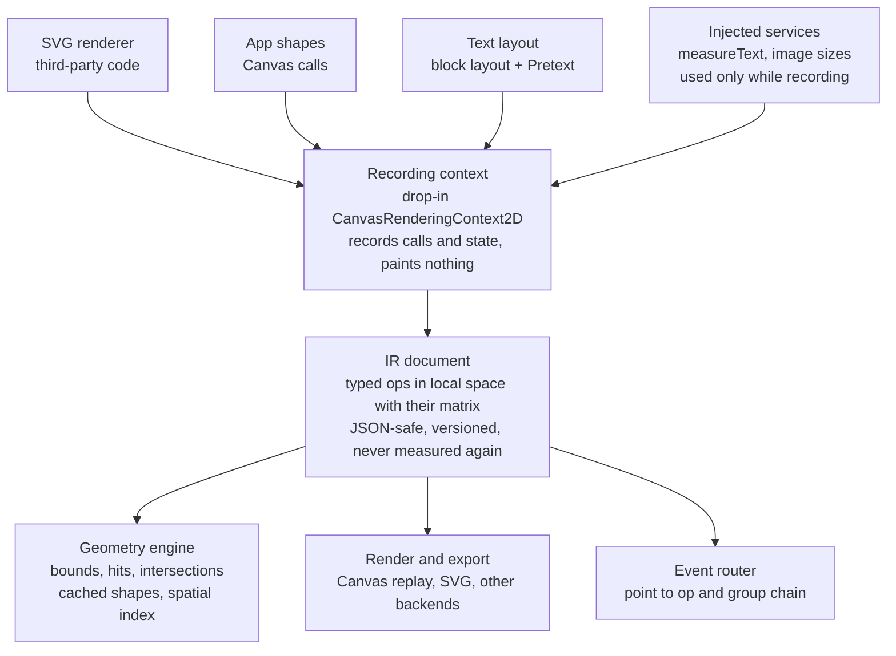

# CanvasIR: design intent

## Purpose

CanvasIR is a drop-in replacement for `CanvasRenderingContext2D` that records drawing instead of painting it. Any code that draws to a canvas (an SVG-to-canvas renderer, a chart library, our own shapes, a rich-text layout) can draw into it unchanged, and the result is a structured, JSON-safe intermediate representation.

From that IR we derive, without a browser:

- **Geometry queries:** bounds, point hit tests, rect queries, intersections, closest point, normals, anchors.
- **Transformations:** move, scale, rotate or re-parent recorded objects and keep every query exact.
- **Rendering:** replay to a real canvas, export to SVG, or feed another backend.
- **Interaction:** pointer events routed to the recorded object under the cursor.

The payoff is that anything that can render to Canvas gets hit testing and geometry for free. An SVG asset drawn through an SVG-to-canvas library becomes selectable, snappable objects. Rich text from an HTML editor, laid out and drawn as `fillText` calls, becomes text objects with real bounds.

## Principles

Each principle below is a constraint we commit to. The reason is the failure it prevents.

| Principle | Why |
| --- | --- |
| **Exact Canvas geometry, not pixel fidelity.** Exact: path construction as the spec defines it (current point after `closePath`, implicit `moveTo` in `bezierCurveTo`, `arc` connecting lines), transforms, the `save`/`restore` state model, method signatures, ignoring non-finite arguments. Stored for replay but not modelled in geometry: shadows, filters, compositing. Out of scope: rasterization and pixel reads. | A partial or "Canvas-like" API breaks the first third-party renderer that draws into it. The value of the project is that unmodified code works. |
| **Record what was called, not what it means.** Ops store the call's arguments plus the transform and state in effect. Derived data (world-space outlines, bounds) is computed and cached, never the stored truth. | Baking transforms into points loses information: arcs under rotation or scale come out wrong, and text and images can't be represented at all. |
| **Every op is typed.** Ops are a discriminated union (`fill`, `stroke`, `clear`, later `text`, `image`, `clip`, `group`), versioned from the first release. | An IR that can only hold one kind of op has to be broken to add a second. |
| **Pure core, injected environment.** The core never touches the DOM. Anything environment-dependent (text measurement, image sizes, fonts) is an injected service, called only while recording. | Tests, codecs and servers must run identically in Bun, Node and every browser. |
| **Measured once, stored.** Whatever was measured while recording (text advance widths, image sizes) is written into the op. | After recording, no query, transform or export ever needs a measurer, so the IR is portable. |
| **Exact where cheap, flattened where not.** Lines and arcs are queried analytically; Béziers flatten with an explicit tolerance. Results are cached per op and invalidated by version. | Repeated flattening of every op on every query does not scale to a board of thousands of objects. |
| **Library and tooling are separate packages.** The playground and debugging tools depend on the library, never the reverse. | Tooling types and helpers leaking into the public API make the library harder to version. |

## Architecture

Every source of drawing goes through the same Canvas context, and every consumer reads the same IR.



The text layout layer also reads container outlines from the geometry engine, and the event router hit-tests through it. Only the recording context calls the injected services.

## IR data model

A document is an ordered list of typed ops. Each op keeps the Canvas state it was drawn with, including its own transform, so geometry and replay are both exact. The phase 1 types live in [`packages/core/src/types.ts`](../packages/core/src/types.ts); the target shape is:

```ts
type Op = FillOp | StrokeOp | ClearOp | TextOp | ImageOp | ClipOp | GroupOp;

interface OpBase {
  id: string;              // stable, assigned at record time
  kind: Op["kind"];
  transform: Matrix2D;     // CTM when the op was drawn
  compositing: Compositing; // globalAlpha, composite operation, shadows, filter
  clip?: ClipRef;          // active clip region, if any
  meta?: Record<string, JsonValue>; // caller tags: object id, layer, source element
}

interface TextOp extends OpBase {
  kind: "text";
  paint: "fill" | "stroke";
  text: string;
  x: number; y: number; maxWidth?: number;
  font: string; textAlign: CanvasTextAlign; textBaseline: CanvasTextBaseline;
  direction: CanvasDirection; letterSpacing: string;
  metrics: { advance: number; ascent: number; descent: number }; // measured at record time
}
```

- **Local space plus a matrix.** Path geometry stays in the coordinates the caller used; each subpath start and segment names the matrix it was added under. World-space outlines are derived and cached. Arcs and ellipses stay exact under any affine transform.
- **Paths keep their source primitives.** `arc`, `ellipse` and curves are stored as themselves, so SVG export and editing tools see what was drawn. They are lowered to Béziers only inside geometry.
- **Groups are optional structure.** A caller (or a `save`/`restore` convention) can open a group that carries an id and `meta`. Hit tests report the op and its group chain, so "the SVG asset" or "the text block" is selectable as one object.
- **Paints are full Canvas paints.** Colors, linear, radial and conic gradients, and patterns referencing an image op by id.
- **Versioned schema.** `version` on the document from v1, Zod schemas per version, and explicit migrations.

## Recording context

The context must pass as a `CanvasRenderingContext2D` for the renderers we care about, so coverage is measured by running them, not by a hand-picked subset.

| Area | Calls | Notes |
| --- | --- | --- |
| Paths | `beginPath`, `moveTo`, `lineTo`, `bezierCurveTo`, `quadraticCurveTo`, `arc`, `arcTo`, `ellipse`, `rect`, `roundRect`, `closePath`, `Path2D` | Spec semantics for the current point and implicit `moveTo`. |
| Painting | `fill`, `stroke`, `fillRect`, `strokeRect`, `clearRect`, `fill(path2d)`, `stroke(path2d)` | `clearRect` is recorded as an op, not dropped. |
| Transform | `translate`, `scale`, `rotate`, `transform`, `setTransform` (both forms), `getTransform`, `resetTransform` | `getTransform` returns a real `DOMMatrix` where one exists. |
| State | `save`, `restore`, `reset`, all style properties, `setLineDash`, `getLineDash`, `globalAlpha`, `globalCompositeOperation`, `filter`, shadows | Shadows and filters are stored for replay; geometry ignores them at first. |
| Paints | `createLinearGradient`, `createRadialGradient`, `createConicGradient`, `createPattern` | Gradient objects record their stops. |
| Clipping | `clip`, `clip(path2d)` | Clip regions participate in hit testing. |
| Text | `fillText`, `strokeText`, `measureText`, `font`, `textAlign`, `textBaseline`, `direction`, `letterSpacing`, `wordSpacing` | `measureText` goes to the injected measurer. |
| Images | `drawImage` (3, 5 and 9 argument forms) | Stores a source reference and size, not pixels. |
| Hit APIs | `isPointInPath`, `isPointInStroke` | Answered by the geometry engine, so renderers that test points still work. |
| Pixels | `getImageData`, `putImageData`, `createImageData` | Out of scope. Calls throw a clear "unsupported" error. |

The acceptance test is a corpus: an SVG-to-canvas renderer drawing a set of SVG files, plus our own fixtures, replayed onto a real canvas in a browser job and compared pixel-for-pixel with direct rendering. That job runs nightly or before a release; the fast Bun tests are the everyday loop.

## Geometry queries

The engine answers queries in world space from cached, per-op derived shapes, behind a spatial index.

- **Derived shapes per op:** world-space segments, flattened polylines keyed by tolerance, fill outline and stroke outline (width, caps, joins, dash). Text and image ops derive a box (or line boxes) through their matrix.
- **Paint-aware results.** A hit on a stroke uses the stroke outline, not a distance threshold. Clips cut both fill and stroke. Fully transparent paint can be excluded by option.
- **Queries:** `bounds` (geometry and paint), `hitTest(point, tolerance)` in z-order with the group chain, `queryRect` (intersects, contains, enclosed), `intersections(a, b)`, `closestPoint` with tangent and normal, `anchors` (vertices, extremes, midpoints, text baselines and box corners), `isPointInPath` / `isPointInStroke`.
- **Performance:** a spatial index (R-tree or uniform grid) over op bounds as the broad phase. Caches are invalidated by op version, so moving one object recomputes only that object. Target: a hit test on 10,000 ops well under a frame, measured by a benchmark in CI.
- **Precision:** line and arc queries are analytic. Bézier queries use flattening with an explicit tolerance in world units, plus Newton refinement for closest point.

Transforms are applied to ops by composing onto their stored matrices. Nothing is re-recorded, and caches for that op are dropped.

## Rendering and export

Replay is the inverse of recording: each op sets its saved state and makes the same Canvas calls, so the replay target can be any real `CanvasRenderingContext2D` or `OffscreenCanvasRenderingContext2D` with no adapter.

- **Canvas replay** of a whole document, a subset of op ids, or a viewport (through the spatial index), with an optional extra view matrix for pan and zoom.
- **SVG export:** paths with their source primitives, `<text>` with stored positions and transforms, `<image>`, gradients, clip paths.
- **Other backends** through a small interface that consumes ops, not Canvas calls, so a WebGL or PDF backend doesn't have to emulate Canvas.

## Interaction

The core turns pointer positions into targets. It does not own DOM listeners.

- **Event router:** the host feeds `pointerdown`/`move`/`up`, wheel and keyboard events with a view matrix. The router hit-tests in world space and emits `enter`, `leave`, `down`, `up`, `click`, `dragstart`, `drag`, `dragend` with the target op, its group chain and the local-space point.
- **Capture and bubbling** along the group chain, so a handler on a group (an SVG asset, a text block) sees events from its parts.
- **Hover and selection state** live outside the IR, keyed by op or group id, so the document stays a pure description of what was drawn.
- **Text targets** report the line hit. Mapping a point to a caret offset is a text-layer concern (below).

## Text

Text enters the IR the same way everything else does, as `fillText` and `strokeText` ops. Layout is a separate, optional layer above the IR that turns rich text into those calls.

**Pipeline:** editor document (ProseMirror, edited as HTML) → block layout (paragraphs, headings, lists, spacing; ours) → paragraph layout with [Pretext](https://github.com/chenglou/pretext) (`@chenglou/pretext`, including `rich-inline` for mixed fonts) → `fillText` per run into the recording context → IR.

- **Why Pretext.** The canvas rendering must wrap exactly where the HTML editor wrapped. Pretext reproduces each browser's line-break rules and width corrections (space kerning, emoji, ligatures, CJK and Southeast Asian scripts), and re-layout after `prepare()` is pure arithmetic, so container resizes are cheap.
- **Text block as a group.** The layout layer opens a group with the source document reference, container and layout fingerprint in `meta`, then draws its runs. Hit testing returns the run and the block. Editing re-opens the HTML editor over the block and re-runs layout on commit.
- **Containers are paths, not just rectangles.** Layout walks line bands top to bottom with `layoutNextLineRange` / `layoutNextRichInlineLineRange`. For each band it intersects the band with the container's world outline (from the geometry engine), keeps the x-intervals that are inside for the whole band height, and fills them left to right. A rectangle gives one interval per band, a concave shape several. Text around obstacles is the same with their outlines subtracted. With mixed font sizes, a line that turns out taller than the paragraph's line height is laid out again with the taller band.
- **Bidi.** Pretext breaks right-to-left text correctly but gives no visual order. Each line is drawn with `direction` set from the paragraph. Where order inside a line matters (numbers or punctuation at a break), a UAX #9 implementation splits the line into directional runs drawn in visual order.
- **Caret and selection** come from the stored runs: line from the hit, offset by measuring prefixes of that run's text at edit time. They are only needed in the editor.
- **Out of scope:** glyph outlines as geometry. Text geometry is run boxes, which is what selection, snapping and layout need.

## Determinism, tests and codecs

Only recording and layout touch the environment, and both go through injected services. Everything downstream reads stored data.

- **Codecs never measure.** Serialize, deserialize, migrate, transform, query and export run on stored ops and are identical in Bun, Node and every browser.
- **Stable output.** Same calls in, byte-identical JSON out: ids in record order and a fixed key order.
- **Layout fingerprint.** A laid-out text block stores the font list, engine profile and Pretext version it was measured with. A host can see that a stored layout came from another environment and decide whether to lay it out again; nothing re-lays out implicitly.
- **Measurement fixtures.** Segment widths are captured once per font from a real browser into JSON. Tests install an `OffscreenCanvas` shim that answers `measureText` from that table, so Pretext and our block layout run in Bun as golden-file tests.
- **Three test tiers.** Unit tests in Bun for math and queries (including property tests: transform then query equals query then transform). Golden IR and SVG snapshots for the renderer corpus and text fixtures. A browser job that replays the corpus onto real canvases and compares pixels, and checks Pretext layouts against DOM layout.

## Milestones

The order puts Canvas fidelity and correct geometry first, because everything else, text included, is built on them. Each gate is an automated test in CI; a phase is done when its gate passes, not when its feature list is written.

| Phase | Scope | Gate to next phase |
| --- | --- | --- |
| 1. Core recording | Paths, transforms, state, typed IR, replay; versioned schemas, stable JSON | Pixel-equal replay |
| 2. Geometry | Cached world shapes, stroke outlines, spatial index; bounds, hit test, rect query, closest point | Fast on 10k ops |
| 3. Full Canvas | Paints, clip, `drawImage`, `fillText`, `isPointInPath`; SVG renderer corpus recorded and replayed | Corpus passes |
| 4. Text layout | Block layout + Pretext, measurement fixtures; path containers, bidi runs, layout fingerprint | Matches DOM wraps |
| 5. Interaction | Event router, groups, SVG export; playground as a separate package | |

## Open questions

- Which SVG-to-canvas renderer anchors the corpus (canvg is the likely one), and which Canvas calls does it actually use?
- Groups: explicit `beginGroup`/`endGroup` extension calls, or inferred from `save`/`restore` nesting with an id?
- Stroke outlines: compute exact offset curves, or flatten-and-offset polylines with a tolerance?
- How much of the rich-text block layout (lists, headings, spacing) belongs in this project versus the editor integration?
- Should `drawImage` ops carry intrinsic size only, or an optional alpha mask so transparent image pixels don't register hits?
- Spatial index: R-tree or uniform grid for typical board densities?
- Should interaction move ahead of text layout, right after geometry?
